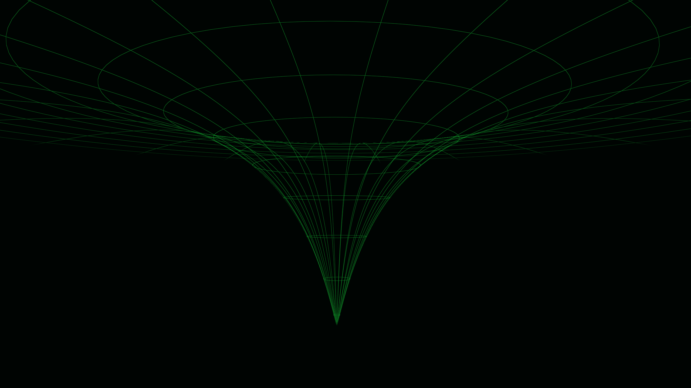

# Spacetime Desktop

A native animated background for **Omarchy 4**: a sparse green wire mesh bends
into a transparent three-dimensional funnel, tapers to a singular point, and
returns to a quiet spacetime field. Five distinct camera routes run for 90
seconds each, making a continuous 7½-minute cycle.



[Watch a short native-rendered excerpt](media/preview.mp4).

The camera explores above and below the mesh, crosses the field and gradually
accelerates toward the point before swooping away. Localized rotation enters
in one direction, settles, then reverses on departure. There is no revealed
lower plane, duplicate tunnel grid, scene crossfade, camera roll, or sky band.
One actual 3D mesh and one wire material render the entire scene.

## Requirements

Tested on **Omarchy 4.0.4**, with its native Quickshell background plugin.
Requires Python 3, Quickshell/Qt Quick, and Qt's shader compiler at
`/usr/lib/qt6/bin/qsb` (provided by Arch's `qt6-shadertools` package).
GPU rendering is required. Other Omarchy versions are not yet verified; the
builder checks the installed background source before creating its integration.

The renderer uses a 96×128 geometry mesh with a deliberately coarser visible
wire grid and caps its offscreen texture at 1920×1080. The timer targets roughly
60 updates per second; actual performance and power use depend on the GPU and
desktop. No external assets or network connection are needed during playback.

## Preview without changing your desktop

```bash
git clone https://github.com/simpleprim8/spacetime-desktop.git "$HOME/.local/share/spacetime-desktop"
cd "$HOME/.local/share/spacetime-desktop"
python3 build.py
./spacetime preview
```

Click the preview to pause or resume it. Close that window when finished.

## Install the animated desktop

From the cloned project directory in an unlocked Omarchy session:

```bash
python3 install.py
```

The installer builds the shaders, adapts the installed Omarchy background,
and installs the user plugin `spacetime.background`. It enables that background
in place of the stock plugin, adds a `spacetime` command and launcher entries,
and may restart the Omarchy shell if a hot reload retains the previous renderer.
It backs up `shell.json`, an earlier copy of this plugin, and an existing
`spacetime` command under `~/.config/omarchy/backups/spacetime-<timestamp>/`.
It also installs a small theme hook that resumes the animation when the
matching Singularity theme is selected.

Keep the clone at its installed location: the launcher command points to it.
The installer uses user configuration only and preserves bar layout, idle
timing and lock preferences. It does not install the Singularity palette.

## Matching theme

```bash
omarchy theme install https://github.com/simpleprim8/omarchy-singularity-theme.git
```

See [Singularity](https://github.com/simpleprim8/omarchy-singularity-theme) for
the matching palette, shell surfaces and static fallback wallpaper.

## Controls

```bash
spacetime status
spacetime pause
spacetime start
spacetime seek 40
spacetime speed 1
spacetime stop
spacetime restore
spacetime enable
```

`stop` shows the current static wallpaper. `restore` enables the stock Omarchy
background plugin. `enable` selects this project's plugin again. If the shell
retains an earlier renderer after switching plugins, run `omarchy restart shell`
from an unlocked desktop. To remove automatic resume on Singularity selection,
remove `~/.config/omarchy/hooks/theme-set.d/80-spacetime-singularity`.

## Future tweaks

- `spacetime.vert`: actual mesh geometry, camera paths, deformation and pacing.
- `spacetime.frag`: visible wire thickness, brightness and transparency.
- `Spacetime.qml`: scene and rendering settings.
- `build.py`: integration with the installed Omarchy background.

Rebuild with `python3 build.py` for a preview, or rerun `python3 install.py` to
update the installed plugin. `plugin/` and `.qsb` files are generated locally.

The approved animation has native GPU frame coverage across all five routes
and matching loop-boundary frames. The original installation was checked live.
The public installer is additionally checked against a fresh temporary home
directory; installation on another physical machine remains unverified.

## Credits and license

Created by **simpleprim8**, with AI-assisted implementation and iteration.
Inspired by classic cinematic spacetime wireframes. All distributed artwork is
rendered from this project's procedural shaders; no film frames or source
recording are included.

The background host integration is generated from the user's installed Omarchy
source. Omarchy is by David Heinemeier Hansson and contributors. This is an
independent community project, MIT licensed; see [LICENSE](LICENSE).
